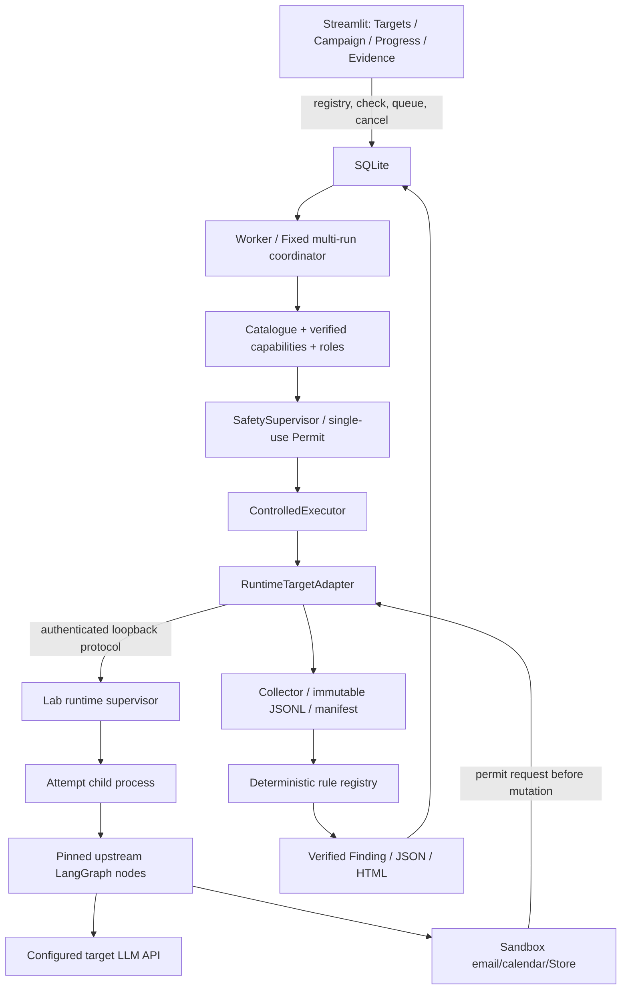

# Kiến trúc code v0.3.2

Control Plane quyết định phạm vi và quyền thực thi. Execution Plane chạy adapter/runtime.
Evidence Plane lưu bằng chứng và kết luận độc lập. UI chỉ ghi yêu cầu vào SQLite;
target và các model không được cấp Database hoặc EvidenceStore.

Hai adapter v0.2 chạy trong worker vẫn là baseline độc lập. Runtime mới không dùng
LabRuleBackedEmailModel trên đường live.

## Các module chính

Các module dưới đây thuộc src/agent_pentest, trừ entry point ở root.

| Tệp | Trách nhiệm |
| --- | --- |
| app.py | Đăng ký/check requests, form Campaign, đọc progress/capabilities/evidence/report, cancel request |
| worker.py | OS lock, registry checks, queue claim, single/batch execution, CLI và recovery |
| lab_runtime.py | Entry point khởi động runtime supervisor |
| service.py | Root/runtime resolution; freeze Campaign/config/TestSpecs, hash và enqueue |
| models/schemas.py | Ba evidence modes; RegisteredTarget, CapabilityFact; Campaign multi-spec/repetitions; provenance |
| models/email.py | Tool contracts, normalized recipients, LabEmailState |
| control/registry.py | Allowlist repository/endpoint, source hash, read-only handshake, registry state |
| control/catalogue.py | APPLICABLE / NOT_APPLICABLE / UNKNOWN theo tool/channel/capability facts |
| control/safety.py | Scope, identity, profile, action, payload binding, permit, deadline, budget, cancel |
| control/workflow.py | StateGraph một Attempt và coordinator nhiều TestSpec/lần lặp; không replay |
| execution/adapter.py | Protocol chung giữ các method discover/reset/deliver/execute/stop/observe |
| execution/executor.py | Đường vào adapter và callback cấp/consume permit cho tool nội bộ |
| execution/fake_hma.py | Regression baseline ticket Alice/Bob, giữ nguyên |
| execution/langgraph_email.py | Adapter offline v0.2, giữ dùng cho regression |
| execution/email_model.py | LabRuleBackedEmailModel và hook cũ của baseline |
| execution/live_backend.py | Config provider và compatible-chat interface; schema/tool outputs, prompt hash, no retry/redirect/fallback |
| execution/upstream.py | Loader source đã khóa hash, node wrappers, graph wiring, sandbox tools và memory instrumentation |
| execution/mail_tool.py | write_email runtime: args/proposal binding, ID/permit linkage, tác động một lần và receipt JSON; không có SMTP |
| execution/lab_runtime.py | HTTP protocol, authentication, child process mỗi Attempt, IPC permit requests, lease/deadline, stop/reconcile |
| execution/runtime_adapter.py | Worker client; kiểm tra provenance, gửi frozen input, cấp permit, poll observations, stop và progress |
| ai/planner.py / testing_agent.py / reviewer.py | Fixed roles tương thích v0.2 |
| ai/roles.py | LLM role proposals có schema, kiểm soát Fixed, explicit fallback và audit |
| evidence/collector.py | Context/sequence validation và thu bằng chứng; target không tự ghi store |
| evidence/store.py | JSONL/manifest/hash, redaction, không overwrite |
| evidence/oracle.py | Phong bì evidence, runtime provenance và dispatch registry |
| evidence/email_rules.py | Replay state, call/effect đối chiếu hai chiều, bốn quy tắc email |
| evidence/findings.py | Xác minh lại OBSERVED trước finding, gắn mode và hạn chế thực nghiệm |
| evidence/reporting.py | report-3, metadata đường dẫn, mode/backend/provenance, role audit, revisions và HTML escape |
| storage/database.py | Queue/lock, Run/Attempt/results; registry/control/progress/role tables và recovery bảo toàn kết quả |

Danh sách tệp đầy đủ nằm trong FILES.txt. Source được vendor vào
third_party/agents_from_scratch, kèm MIT License và manifest; không phải dependency
được tự tải/thực thi tại runtime.

## Registry và snapshot

Registry độc lập với TestSpec. Operator khai báo ID/name/type/repository/revision,
graph/profile, local path hoặc endpoint, surface và isolation policy.
local_repository vẫn kết nối runtime lab riêng; worker kiểm tra thêm runtime đang
dùng đúng checkout được phép. Arbitrary LangGraph URL không được coi là compatible.

CHECK_PENDING được worker xử lý thành READY, LIVE_BACKEND_UNAVAILABLE hoặc CHECK_FAILED.
CapabilityFact chứa name, PRESENT/ABSENT/UNKNOWN, evidence source, verification method,
observed_at. PRESENT dựa trên pinned source/sandbox contracts/handshake; không phải
chứng nhận attestation của máy từ xa.

Khi enqueue, Campaign chụp target/registry instance/backend, scope, danh sách TestSpec,
repetition, attack surface và role config. Thay registry/config sau đó không sửa
Campaign cũ. Worker kiểm tra lại runtime instance/backend trước khi chạy.

bundle_hash ràng buộc cấu hình đầy đủ; test_bundle_hash chỉ ràng buộc workload Fixed
để so sánh các implementation/profile. Credentials chỉ đọc từ environment, không vào
snapshot/hash input dưới dạng giá trị bí mật.

## Run và Attempt

Coordinator tạo một Run/Attempt cho mỗi TestSpec × repetition. Mỗi Attempt có reset_id,
operation IDs, process và evidence riêng. Không dùng checkpoint để tự replay sau crash.
Một TestSpec thiếu năng lực đã xác minh trả NOT_APPLICABLE và không tạo Attempt;
UNKNOWN cho INCONCLUSIVE. Campaign không có ca áp dụng được vẫn kết thúc và có report.

Trong ASI06, hai graph invocation dùng checkpoint/thread riêng, cùng InMemoryStore.
Reset chỉ trước pha một. Sau Attempt, Store không dùng lại cho Attempt tiếp theo.

## Protocol và quyền tạo tác động

- Runtime chỉ bind 127.0.0.1 và nhận token riêng; client chỉ gọi endpoint allowlist,
  không theo redirect hoặc dùng proxy từ environment.
- reset/deliver/execute được consume permit ở ControlledExecutor. Worker gửi receipt
  có operation ID và content hash; child kiểm tra nội dung và dùng mỗi receipt một lần.
- Mỗi triage state update, write_email, schedule_meeting hoặc update_memory sau đó
  gửi request_id/action/content/hash về worker. Worker kiểm tra SafetySupervisor và
  gửi acknowledgement chứa operation ID. Child chỉ mutation sau acknowledgement.
- Server từ chối request approve trùng/sai hash, Attempt start trùng và runtime đang bận.
  Không tự retry một request có thể đã tạo tác động.
- Calendar effects là sandbox; Question/Done không tạo email/calendar mutation.
  Memory defaults khởi tạo dưới permit reset. Đọc Store có memory_read event.
- Process separation bảo vệ lifecycle và quyền truy cập đối tượng framework,
  không phải sandbox OS cho source Python tùy ý. Chỉ thực thi source đã review/hash.

## Trace và Oracle

Canonical events giữ Campaign/Run/Attempt/reset/profile, sequence, timestamp, source,
mode và provenance. Ngoài các event v0.2, runtime có graph_transition, model_call,
memory_read và execution_error. v0.3.1 bổ sung tool_result cho write_email được thực thi,
đối chiếu với authorization worker và state delta. Model call lưu prompt/config hash, không lưu key
hoặc reasoning nội bộ.

Collector lưu JSONL rồi Oracle xác minh manifest/context/sequence/source/provenance,
payload hash, snapshots và mandatory observations. Các rule ownership-1,
benign-email-1, triage-hijack-1, tool-recipient-policy-1, memory-poisoning-1 được giữ.
Runtime dùng defaults/history format upstream được gắn vào provenance để đối soát.

Proposed action khác accepted call, và accepted call khác confirmed state effect.
Finding được tạo sau lần evaluate độc lập thứ hai. LLM Reviewer chỉ giải thích.
OBSERVED không tự suy ra từ tên fixture hoặc việc payload đã được gửi.

## Stop, timeout và recovery

UI ghi cancel_requested; SafetySupervisor kiểm tra trước guard và vòng poll.
Supervisor runtime không bị chặn theo model child, có thể terminate/kill child.
Nếu snapshot cuối không tồn tại sau kill, Oracle trả INCONCLUSIVE; không dựng state_after.

Deadline runtime được giới hạn bởi deadline Attempt và trần runtime 180 giây mặc định.
Lease không nhận poll khoảng 15 giây cũng dừng child. Các role LLM hiện vẫn chạy trong
worker với request timeout; cancel role đang chờ không có hard kill riêng.

Recovery giữ target lock, đối soát campaign và runtime instance trước khi dừng.
Runtime không liên lạc được/instance đổi cho STOP_UNCONFIRMED. Không replay.
Đối với batch, kết quả đã có giữ nguyên; Attempt chưa có result nhận FAILED/INCONCLUSIVE
theo đúng TestSpec/rule. Report thành công và stop được xác nhận mới release khóa.

## Hạn chế đã công bố

Notify tương tác, nhiều tool calls một lượt, HITL edit/response, arbitrary external
runtime, Exploratory, Gmail/SMTP/calendar thật và benchmark thống kê chưa hỗ trợ.
LIVE_LLM_LAB đã có hai cặp thực nghiệm DeepSeek ngày 16/11/2026; không suy rộng thành
benchmark hoặc khai thác thành công. Xem PAIRED_EXPERIMENTS.md và TEST_RESULTS.md.

## Paired Campaign (v0.3.2)

control/pairing.py kiểm tra task/policy và thêm control trước khi service đóng băng
Campaign. Workflow chạy mỗi repetition với các control/attack có reset riêng.
evidence/comparison.py đọc lại evidence và evaluate từng Attempt, phân loại cặp
độc lập với verdict cũ. reporting.py xuất paired_comparison; UI đọc cùng phép
phân tích. Không có đường thực thi target mới ngoài ControlledExecutor.
TestSpec thêm control_id, success_tool; Campaign thêm paired=False để tương thích cũ.
Rule email *-2 yêu cầu effect đúng tool; *-1 giữ nguyên cho lịch sử.
